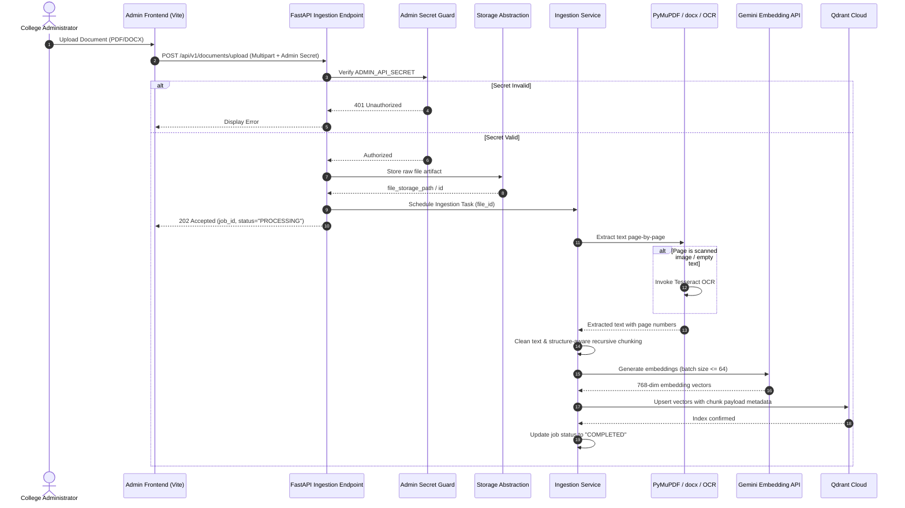
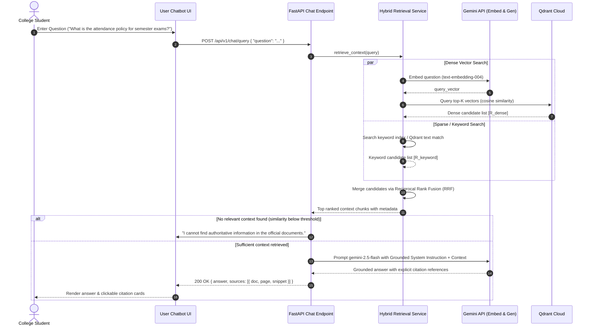

# Data Flow & Execution Workflows

This document details the exact sequence of operations for the two primary lifecycle events in `RAG-Based-College-Knowledge-Assistant`:
1. **Document Ingestion Workflow**
2. **User Query & Retrieval Workflow**

---

## 1. Document Ingestion Workflow

The ingestion pipeline transforms unstructured college documents (PDF, DOCX) into semantically indexed, searchable chunks in Qdrant Cloud.

### Ingestion Step Details:
1. **Upload & Verification**: The administrator submits a PDF or DOCX file via the Admin Panel. The backend verifies the administrative token (`X-Admin-Secret`).
2. **Raw Storage & Hashing**: A SHA-256 hash of the file is calculated to verify idempotency. The raw binary is saved via the `BaseDocumentStorage` abstraction.
3. **Extraction & Selective OCR**:
   - For PDFs, PyMuPDF reads text streams page by page.
   - If a page has fewer than a configurable threshold of characters (e.g. < 50 chars), it is flagged as scanned and passed to Tesseract OCR.
   - For DOCX files, `python-docx` parses paragraphs, heading levels, and tables.
4. **Recursive Structure-Aware Chunking**: Text is split into chunks of ~1000 characters with 200-character overlap, respecting section headings, paragraph breaks, and sentence terminators.
5. **Metadata Tagging**: Each chunk is tagged with:
   - `document_id`: Unique document identifier
   - `document_name`: Filename (e.g. `Academic_Regulations_2025.pdf`)
   - `page_number`: 1-based page index
   - `chunk_index`: Sequence position
   - `chunk_id`: Unique deterministic chunk ID (`{doc_id}_{page}_{index}`)
   - `text`: Chunk text
6. **Batch Embedding**: Batches of chunk texts are sent to the Google Gemini `text-embedding-004` endpoint.
7. **Vector Indexing**: Chunks and their vectors are upserted into Qdrant Cloud under the configured collection name.

---

## 2. User Query & Retrieval Workflow

The query workflow accepts a student question, performs hybrid retrieval, merges candidate passages, and prompts the Gemini LLM to generate an answer grounded in cited documents.

### Query Step Details:
1. **Query Validation**: Chat endpoint validates the query length and schema.
2. **Parallel Hybrid Retrieval**:
   - **Dense Search**: Converts the user's natural query into a 768-dimensional vector and executes an approximate nearest-neighbor query in Qdrant.
   - **Keyword Search**: Performs exact and stemmed keyword matching against document text payloads to capture exact course numbers, dates, or faculty codes.
3. **Reciprocal Rank Fusion (RRF)**:
   - Rank scores are calculated using the standard formula:
     $$\text{RRF\_Score}(d) = \sum_{m \in \{\text{dense}, \text{keyword}\}} \frac{1}{k + \text{rank}_m(d)}$$
     *(with constant $k = 60$)*
   - Chunks are re-ordered by combined RRF score, producing a deduplicated, high-precision context pool.
4. **Context Construction & Prompting**:
   - The top candidate chunks are assembled into a structured prompt with explicit document boundaries and page identifiers.
   - The system prompt forbids speculation, requires citing exact sources, and directs the model to state if the answer cannot be found in the provided excerpts.
5. **Answer Delivery**:
   - The response is returned to the user frontend along with structured source metadata for transparent verification.

