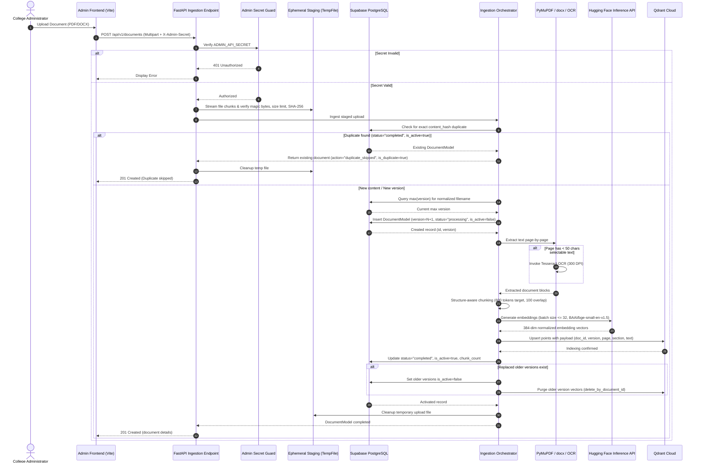
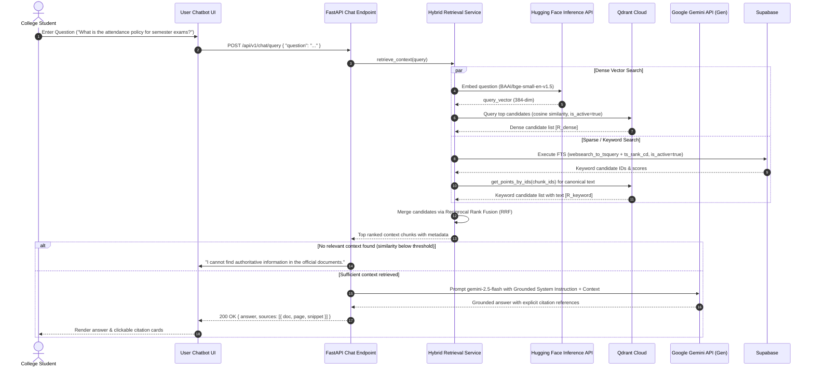

# Data Flow & Execution Workflows

This document details the exact sequence of operations for the two primary lifecycle events in `RAG-Based-College-Knowledge-Assistant`:
1. **Document Ingestion Workflow**
2. **User Query & Retrieval Workflow**

---

## 1. Document Ingestion Workflow

The ingestion pipeline transforms unstructured college documents (PDF, DOCX) into semantically indexed, searchable chunks in Qdrant Cloud.

### Ingestion Step Details:
1. **Upload & Verification**: The administrator submits a PDF or DOCX file via the Admin Panel. The backend verifies the administrative token (`X-Admin-Secret`).
2. **Ephemeral Staging & Hashing**: The file stream is validated against allowed signatures (PDF magic bytes `%PDF-`, DOCX ZIP structure) and staged in a secure temporary file while computing a SHA-256 content hash. Upload size is bounded to `MAX_UPLOAD_SIZE_BYTES` (50 MB).
3. **Supabase Registration & Deduplication**:
   - The orchestrator checks Supabase for an existing completed record with the same content hash. If found, re-indexing is skipped.
   - If a new version is uploaded with the same filename, version is incremented (`version = max + 1`).
   - A document record is inserted into Supabase with `status="processing"` and `is_active=False`.
4. **Extraction & Selective OCR**:
   - For PDFs, `PDFExtractor` (PyMuPDF) extracts text blocks page by page to maintain strict 1:1 page correlation.
   - If a page has fewer than a configurable threshold of characters (default: 50 characters via `OCR_MIN_PAGE_CHARS`), it is flagged as scanned and passed to `TesseractOCRExtractor` (rendered at 300 DPI).
   - For DOCX files, `DOCXExtractor` (`python-docx`) traverses body elements in document order, preserving heading levels (`Heading 1-6`) and converting tables into markdown formatting.
4. **Structure-Aware Chunking**: Text is chunked with `StructureAwareChunker` into units of ~600 tokens with ~100 tokens overlap using `tiktoken` (`cl100k_base`), respecting page boundaries, section headings, and sentence terminators.
5. **Metadata Tagging**: Each chunk is tagged with:
   - `document_id`: Unique document identifier
   - `document_name`: Filename (e.g. `Academic_Regulations_2025.pdf`)
   - `file_type`: Format (`pdf` or `docx`)
   - `page_number`: 1-based page index
   - `chunk_index`: 0-based sequence position
   - `chunk_id`: Unique deterministic chunk ID (`{doc_id}_p{page}_c{index}`)
   - `text`: Chunk text content
   - `token_count`: Number of tokens in chunk
   - `char_count`: Character length of chunk
   - `section_heading`: Nearest active heading context
   - `ocr_applied`: Boolean indicating if OCR was used for this chunk's page
6. **Batch Embedding**: Batches of chunk texts are sent to the Hugging Face `BAAI/bge-small-en-v1.5` inference endpoint (384 dimensions).
7. **Vector Indexing**: Chunks and their vectors are upserted into Qdrant Cloud under the configured collection name.

---

## 2. User Query & Retrieval Workflow

The query workflow accepts a student question, performs hybrid retrieval, merges candidate passages, and prompts the Gemini LLM to generate an answer grounded in cited documents.

### Query Step Details:
1. **Query Validation**: Chat endpoint validates the query length and schema.
2. **Parallel Hybrid Retrieval**:
   - **Dense Search**: Converts the user's natural query into a 384-dimensional vector using `BAAI/bge-small-en-v1.5` and executes an approximate nearest-neighbor query in Qdrant with `is_active=True` filtering.
   - **Keyword Search**: Executes PostgreSQL full-text search against the `document_chunks` GIN `tsvector` index using `websearch_to_tsquery` and `ts_rank_cd`, fetching canonical text from Qdrant via `get_points_by_ids` without duplicating text in relational storage.
3. **Reciprocal Rank Fusion (RRF)**:
   - Rank scores are calculated using the standard formula:
     $$\text{RRF\_Score}(d) = \sum_{m \in \{\text{dense}, \text{keyword}\}} \frac{1}{k + \text{rank}_m(d)}$$
     *(with constant $k = 60$)*
   - Chunks are re-ordered by combined RRF score, producing a deduplicated, high-precision context pool.
4. **Context Construction & Prompting**:
   - The top candidate chunks are assembled into a structured prompt with explicit document boundaries and page identifiers.
   - The system prompt forbids speculation, requires citing exact sources, and directs the model to state if the answer cannot be found in the provided excerpts.
5. **Answer Delivery**:
   - The response is returned to the user frontend along with structured source metadata for transparent verification.

