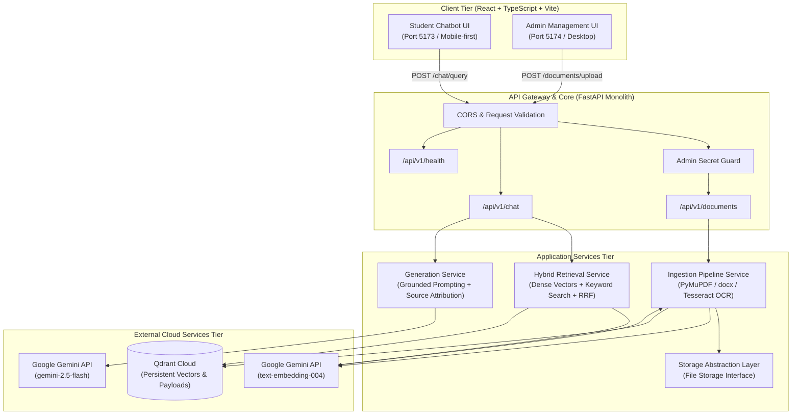

# System Architecture

## 1. High-Level Overview

`RAG-Based-College-Knowledge-Assistant` is a Retrieval-Augmented Generation (RAG) platform tailored for higher education institutions. The system enables students to query college policies, academic calendars, syllabi, fee structures, and campus procedures, delivering answers strictly grounded in official documents with verifiable citations.

The architecture emphasizes modularity, zero vendor lock-in where feasible, persistent cloud vector storage without local disk dependencies, and low maintenance overhead.

---

## 2. Component Breakdown

### 2.1 User Frontend (`frontend/user-app`)
- **Technology**: React 18/19, TypeScript, Vite, Tailwind CSS.
- **Role**: Responsive, mobile-first conversational chat interface for students.
- **Key Responsibilities**:
  - Accept natural-language queries.
  - Display AI responses with distinct, expandable source citation cards (document name, page number, matching snippet).
  - Provide clear loading states, network error handling, and session conversation display.
  - Communicate with backend using typed HTTP services (`services/api.ts`).

### 2.2 Admin Frontend (`frontend/admin-app`)
- **Technology**: React 18/19, TypeScript, Vite, Tailwind CSS.
- **Role**: Clean administrative workspace for document management.
- **Key Responsibilities**:
  - Drag-and-drop file upload for PDF and DOCX files.
  - Document status dashboard (uploaded, processing, indexed, failed).
  - Ingestion progress tracking and error log inspection.
  - Document deletion or re-indexing management.

### 2.3 Backend Modular Monolith (`backend/app`)
- **Technology**: Python 3.11+, FastAPI, Uvicorn, Pydantic v2.
- **Role**: Central coordinator for document processing, retrieval, and generation.
- **Modules**:
  - `core`: Centralized environment configuration (`pydantic-settings`), custom logging, error handlers.
  - `api`: Versioned route controllers (`/api/v1/health`, `/api/v1/documents`, `/api/v1/chat`).
  - `schemas`: Strict Pydantic models for request validation and response contracts.
  - `ingestion`: File parsing, text extraction, selective OCR, structure-aware chunking.
  - `retrieval`: Dense vector querying, keyword candidate matching, Reciprocal Rank Fusion (RRF).
  - `generation`: Context synthesis, prompt building with strict grounding constraints, citation formatting.
  - `vector_store`: Interface and client for Qdrant Cloud.
  - `storage`: Pluggable storage abstraction for raw document persistence without local disk coupling.

### 2.4 Vector Storage Tier (`Qdrant Cloud`)
- **Role**: Managed vector database.
- **Storage Strategy**:
  - Vectors generated from chunk text via `text-embedding-004` (768 dimensions).
  - Rich payloads containing `document_id`, `document_name`, `page_number`, `chunk_index`, `text_content`, `created_at`, and `file_hash`.
  - HNSW indexing enabled for real-time nearest neighbor similarity search.

### 2.5 External LLM & Embedding Tier (`Google Gemini API`)
- **Embeddings**: `text-embedding-004` for converting text chunks and user queries into dense semantic representations.
- **Answer Generation**: `gemini-2.5-flash` for fast, cost-effective generation adhering to strict context-grounding prompts.

---

## 3. Storage Abstraction Layer

The backend is explicitly designed to avoid hard dependencies on local disk persistence:
- An abstract class `BaseDocumentStorage` defines operations: `save_document`, `get_document`, `delete_document`, and `exists`.
- **Development implementation**: Ephemeral local or memory buffer storage.
- **Production implementation**: Cloud blob storage (e.g. AWS S3, Cloudflare R2, Google Cloud Storage, or Supabase Storage) easily plugged in by configuring an environment variable without modifying business logic.

---

## 4. Operational Invariants & Concurrency

- **Target Capacity**: ~10 concurrent active users.
- **Concurrency Model**: Native Python asynchronous I/O (`async`/`await`) for HTTP requests to external APIs (Gemini, Qdrant).
- **CPU-Intensive Tasks**: PDF parsing, OCR image processing, and chunking run in thread executors to keep the asyncio event loop responsive.
- **Stateless Application**: Backend instances carry no in-memory state that prevents multiple instances from operating concurrently.

