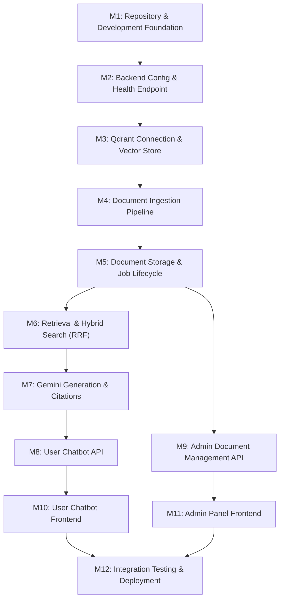

# Implementation Plan & Roadmap

This document outlines the systematic, milestone-driven execution plan for building `RAG-Based-College-Knowledge-Assistant`.

---

## Milestone Dependency Graph

---

## Milestone Breakdown

### Milestone 1: Repository & Development Foundation
- **Goal**: Establish project monorepo structure, documentation, governance rules (`AGENTS.md`), ADRs, `.gitignore`, and environment configuration templates.
- **Dependencies**: None.
- **Outputs**:
  - `AGENTS.md`
  - `docs/` tree (Architecture, Decisions, Development, Project tracking)
  - Root `.gitignore`, `.env.example`, `docker-compose.yml`

### Milestone 2: Backend Configuration & Health Endpoint
- **Goal**: Set up FastAPI modular monolith core, Pydantic settings, structured logging, CORS configuration, and an isolated `/api/v1/health` endpoint.
- **Dependencies**: Milestone 1.
- **Outputs**:
  - `backend/app/main.py`
  - `backend/app/core/config.py` & `logging.py`
  - `backend/app/api/v1/health.py`
  - `backend/tests/test_health.py` passing verification.

### Milestone 3: Qdrant Connection & Vector-Store Integration
- **Goal**: Implement Qdrant Cloud client wrapper behind `BaseVectorStore` interface, collection initialization routines, vector dimension alignment (768-dim), and payload indexing.
- **Dependencies**: Milestone 2.
- **Outputs**:
  - `backend/app/vector_store/base.py` & `qdrant.py`
  - Connection health check & collection bootstrap script.

### Milestone 4: Document Ingestion Pipeline
- **Goal**: Implement format-specific extraction (PyMuPDF for PDF, python-docx for DOCX), selective OCR via Tesseract, recursive structure-aware chunking, and metadata preservation.
- **Dependencies**: Milestone 3.
- **Outputs**:
  - `backend/app/ingestion/extractors/` (PDF, DOCX, OCR)
  - `backend/app/ingestion/chunking.py`
  - Unit tests for chunk boundary fidelity.

### Milestone 5: Document Storage & Ingestion Job Handling
- **Goal**: Implement `BaseDocumentStorage` abstraction, file hashing for idempotency, background job execution, and ingestion status tracking stored in Qdrant payloads.
- **Dependencies**: Milestone 4.
- **Outputs**:
  - `backend/app/storage/base.py` & `local.py`
  - `backend/app/ingestion/pipeline.py`
  - Ingestion status update handlers.

### Milestone 6: Retrieval & Hybrid Search
- **Goal**: Implement dense vector search against Qdrant, lightweight keyword retrieval over document payloads, and Reciprocal Rank Fusion (RRF) to merge candidate lists.
- **Dependencies**: Milestone 5.
- **Outputs**:
  - `backend/app/retrieval/dense.py`
  - `backend/app/retrieval/keyword.py`
  - `backend/app/retrieval/rrf.py` & `hybrid.py`
  - Unit tests for RRF mathematical correctness.

### Milestone 7: Gemini Generation & Source Citations
- **Goal**: Integrate Google Gemini LLM (`gemini-2.5-flash`) with prompt templates strictly enforcing source-grounded answers, citation markers, and fallback behavior when context is absent.
- **Dependencies**: Milestone 6.
- **Outputs**:
  - `backend/app/generation/service.py`
  - Grounded prompt templates and citation parser.

### Milestone 8: User Chatbot APIs
- **Goal**: Expose public student chat endpoints with input validation, question preprocessing, retrieval/generation orchestration, and structured citation responses.
- **Dependencies**: Milestone 7.
- **Outputs**:
  - `backend/app/api/v1/chat.py`
  - Pydantic models for request/response contracts.

### Milestone 9: Admin Document Management APIs
- **Goal**: Expose administrative endpoints for document upload, job status polling, and document deletion, protected by `X-Admin-Secret` header guard.
- **Dependencies**: Milestone 5.
- **Outputs**:
  - `backend/app/api/v1/documents.py`
  - Multipart upload handler and status endpoints.

### Milestone 10: User Chatbot Frontend
- **Goal**: Build responsive, mobile-first student chat UI in `frontend/user-app` with streaming/loading indicators, message history display, and collapsible source citation cards.
- **Dependencies**: Milestone 8.
- **Outputs**:
  - Chat interface components, API client (`services/api.ts`).

### Milestone 11: Admin Frontend
- **Goal**: Build administrator interface in `frontend/admin-app` with drag-and-drop document upload, processing status table, error log display, and deletion controls.
- **Dependencies**: Milestone 9.
- **Outputs**:
  - Document upload view, status table, admin API client.

### Milestone 12: Integration Testing & Deployment
- **Goal**: Conduct end-to-end smoke verification across frontends and backend, verify error cases, and finalize free-tier deployment configurations (Vercel, Render/Railway, Qdrant Cloud).
- **Dependencies**: Milestones 10 & 11.
- **Outputs**:
  - Smoke test report, deployment documentation, production readiness checklist.

